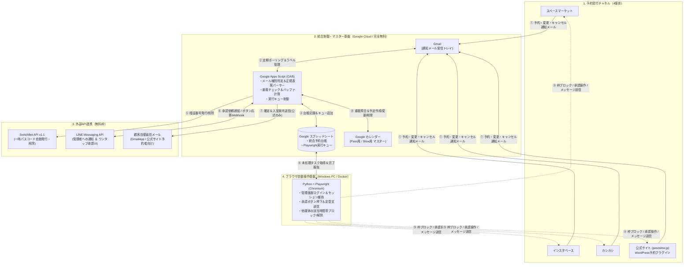
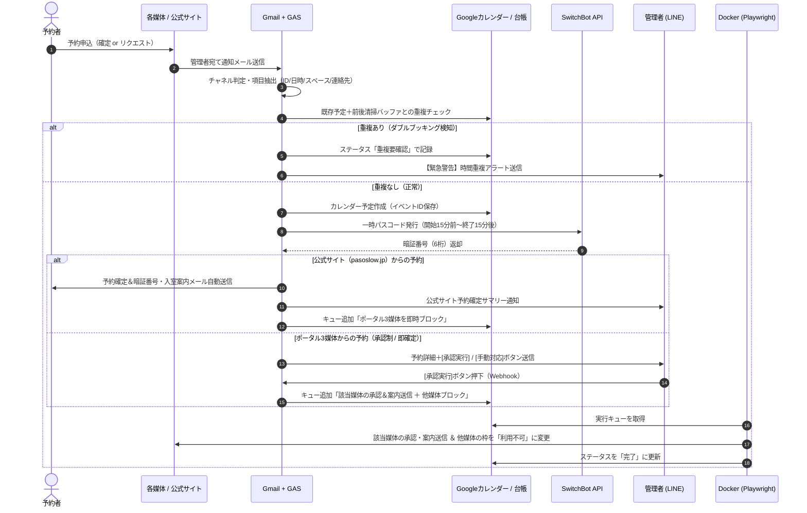
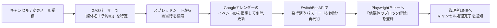

# 4チャネル横断 予約処理半自動化システム アーキテクチャ設計書

## 1. システム概要
本システムは、レンタルスペース（Paso / Slow 等）の4つの予約チャネル（スペースマーケット・インスタベース・カシカシ・公式サイト `pasoslow.jp`）における予約受付・ダブルブッキング防止・スマートロック発行・顧客案内・管理画面操作を**完全無料（0円）構成**で半自動化するシステムである。

### 設計の基本方針
1. **入り口の完全統一（メールマスター方式）：** 各媒体の標準カレンダー同期（挙動差異や二重登録の原因）は使用せず、全4チャネルから届く「管理者宛て通知メール」を唯一の正（マスター）としてGmail＋GASで集約する。
2. **Human-in-the-Loop（半自動承認）：** 規約違反やトラブルリスクのあるポータル予約はLINEへ承認通知を送り、管理者のワンタップで後続処理を実行する。公式サイト予約は重複がなければ即時自動確定とする。
3. **ハイブリッド実行基盤：** 24時間365日の監視・台帳化・鍵発行・通知はGoogleクラウド（GAS）で常時稼働させ、ブラウザ操作が必要な管理画面の枠止め・承認ボタン押下は手元PC（Docker ＋ Playwright）で実行する。

---

## 2. システム全体アーキテクチャ図

---

## 3. 予約種別ごとの処理シーケンス図

### 3.1 新規予約確定時の処理フロー（全チャネル共通〜分岐）

### 3.2 キャンセル・日時変更時の同期フロー

---

## 4. データ設計（Googleスプレッドシート構成）

### シート1：`予約マスター台帳`
すべてのチャネルの予約を一元管理するメインテーブル。

| 列 | カラム名 | データ型 | 説明・格納例 |
| :--- | :--- | :--- | :--- |
| A | `internal_id` | 文字列 | システム管理ID（例：`RES-20261128-001`） |
| B | `channel` | 文字列 | 媒体名（`spacemarket` / `instabase` / `kashikashi` / `official`） |
| C | `external_res_id` | 文字列 | 各媒体の予約番号（名寄せ・キャンセル時の検索キー） |
| D | `space_name` | 文字列 | 対象スペース（`Paso` / `Slow`） |
| E | `status` | 文字列 | `承認待ち` / `確定(操作待ち)` / `確定(完了)` / `キャンセル` / `重複エラー` |
| F | `start_at` | 日時 | 利用開始日時（`2026/12/01 10:00`） |
| G | `end_at` | 日時 | 利用終了日時（`2026/12/01 13:00`） |
| H | `guest_name` | 文字列 | 予約者氏名 |
| I | `guest_email` | 文字列 | 予約者メールアドレス（公式サイト予約時のみ格納） |
| J | `purpose_options` | 文字列 | 利用目的・人数・オプション（酸素カプセル等） |
| K | `pin_code` | 文字列 | SwitchBotで発行した6桁暗証番号 |
| L | `gcal_event_id` | 文字列 | 登録したGoogleカレンダーのイベントID（変更・削除用） |
| M | `updated_at` | 日時 | 最終更新タイムスタンプ |

### シート2：`Playwright実行キュー`
GASからDocker上のPlaywrightワーカーへブラウザ操作を指示するための連携テーブル。

| 列 | カラム名 | 説明 |
| :--- | :--- | :--- |
| A | `queue_id` | キュー識別ID |
| B | `target_channel` | 操作対象媒体（`spacemarket` / `instabase` / `kashikashi` / `wordpress`） |
| C | `action_type` | `APPROVE_AND_SEND`（承認＆案内送信） / `BLOCK_SLOT`（枠止め） / `UNBLOCK_SLOT`（枠解除） |
| D | `space_name` | `Paso` / `Slow` |
| E | `start_at` / `end_at` | 対象時間帯 |
| F | `message_body` | 送信する入室案内文（`APPROVE_AND_SEND` 時のみ） |
| G | `exec_status` | `PENDING`（未実行） / `RUNNING`（実行中） / `DONE`（完了） / `ERROR`（要手動対応） |
| H | `error_log` | 失敗時のスクリーンショットパス・エラー内容 |

---

## 5. 技術スタック・コスト構成一覧

| レイヤー | 採用技術・サービス | プラン・費用 | 役割 |
| :--- | :--- | :--- | :--- |
| **メール受信・解析** | Gmail ＋ Google Apps Script | **無料**（Google標準枠） | 1〜5分間隔のトリガー実行、正規表現パース |
| **データベース・キュー** | Google スプレッドシート | **無料**（Google標準枠） | 予約台帳、Playwrightとの非同期連携キュー |
| **スケジュール管理** | Google カレンダー | **無料**（Google標準枠） | スペース別空き枠判定、清掃バッファ管理 |
| **スマートロック制御** | SwitchBot API (v1.1) | **無料**（1日1万回まで） | 期間限定パスコードの自動生成・無効化 |
| **管理者通知・承認UI** | LINE Messaging API | **無料**（月200通まで） | Flex Messageによる予約通知・承認ボタン操作 |
| **自動ブラウザ操作** | Docker ＋ Python ＋ Playwright | **無料**（OSS・ローカル稼働） | 管理画面のログイン維持、承認操作、在庫ブロック |

---

## 6. セキュリティ・異常系フォールバック設計

1. **認証情報の分離管理**
   * 3媒体およびWordPressのログインID・パスワード、各種APIキーはソースコード（Gitリポジトリ）に一切含めず、GASの「スクリプトプロパティ」およびDockerの「`.env`（`.gitignore`対象）」に隔離する。
2. **2段階認証・HTML構造変更時の安全停止**
   * Playwrightで管理画面操作中にログイン画面の2段階認証（SMS/メール認証）やDOM要素の不一致が発生した場合、無限リトライを行わず即座にステータスを `ERROR` とし、画面キャプチャを保存した上で管理者LINEへ「手動操作が必要です」と通知する。
3. **PC停止時のタイムラグ制御**
   * Windows PCがスリープまたは電源オフの間に予約が入った場合、GAS側の台帳・カレンダー・鍵発行までは即時完了させ、LINE通知に「※PC停止中のため他媒体の枠止め待機中」と明記する。PC起動時にDockerワーカーが `PENDING` キューを順次消化する。